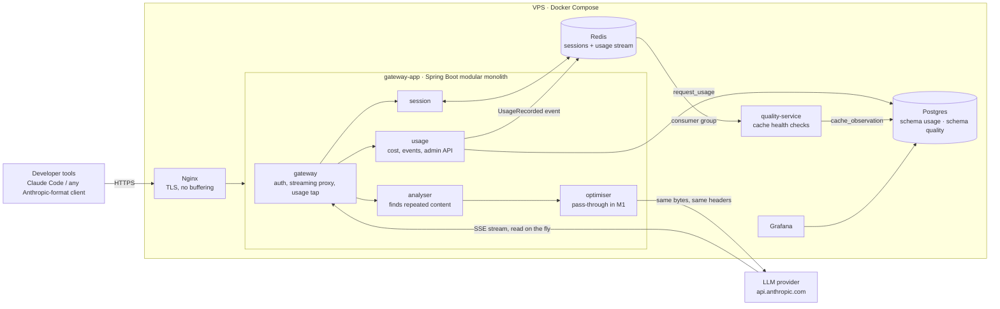

# Token Engine

A model-agnostic LLM gateway that cuts token usage for AI coding agents like Claude Code, without hurting quality or breaking prompt caching.

Developers point their coding tool at the gateway instead of the provider. The gateway streams every request and response through unchanged, measures exactly where tokens go, and (from milestone 2) removes wasted context before it reaches the model.

> **Status: milestone 1, baseline.** The gateway is a transparent pass-through that records exact token usage, cost, cache hits and detected waste. Run it for a week to get the baseline every later saving is measured against.

## Architecture



**Request flow for `POST /v1/messages`:** identify the developer by their gateway key → count the request in its Claude Code session (Redis, 2 h sliding TTL) → analyse the conversation for repeated content (read-only) → optimise (pass-through for now) → stream to the provider and back, flushing every chunk while a tap reads the `usage` events → record usage asynchronously → publish `UsageRecorded` → the quality service checks prompt caching is healthy.

### Design rules

- **Never change the cached prefix.** Anthropic bills cache reads at a small fraction of input price. Rewriting the `system` array, `tools` or earlier messages breaks the cache and can cost more than it saves, and can trigger thinking-signature errors. Optimisers may only touch new, uncached content.
- **Forward as open lists.** Every `anthropic-*` and `x-claude-code-*` header and every body field passes through untouched, per [Claude Code's gateway guide](https://code.claude.com/docs/en/llm-gateway-protocol). Error bodies are forwarded unmodified, so Claude Code's retry logic still works.
- **Fail open.** If the analyser, optimiser, session store or database fails, the request still goes through unchanged.
- **Exact numbers.** Tokens come from the provider's own `usage` block, not estimates.

## Tech stack

| Layer | Choice |
| --- | --- |
| Language | Java 25 (LTS), virtual threads |
| Framework | Spring Boot 4.1, Spring MVC (no reactive code) |
| Modularity | Spring Modulith 2.1: boundaries verified in a test, modules talk via events |
| Proxy | JDK `HttpClient` streaming (see note below) |
| Data | Spring Data JPA + Flyway, Postgres 17 with pgvector, `JdbcClient` for reporting |
| Cache and messaging | Spring Data Redis: sessions + a Redis stream to the quality service |
| Boilerplate | Lombok, Java records for DTOs |
| API docs | springdoc-openapi 3 + Swagger UI |
| Observability | Actuator, Micrometer/Prometheus, Grafana with a provisioned dashboard |
| Edge | Nginx, Let's Encrypt |

**Why not Spring Cloud Gateway?** The core feature is reading token usage out of the SSE stream while forwarding it byte for byte. A plain streaming proxy on virtual threads does that in about 150 lines, with nothing buffered and full control of flushing. Spring Cloud Gateway Server MVC can be added in front later for rate limiting and routing.

## Project structure

```text
token-engine/
├── gateway-app/                          modular monolith, port 8080
│   └── src/main/java/com/tokenengine/
│       ├── gateway/internal/             ProxyController, UpstreamProxy, SSE/JSON usage taps, developer keys
│       ├── session/{api,internal}/       SessionService on Redis
│       ├── analyser/{api,internal}/      ContextAnalyser, DuplicateContentDetector
│       ├── optimiser/{api,internal}/     Optimiser contract, PassThroughOptimiser
│       ├── usage/{api,internal}/         RequestUsage, UsageRecorded, pricing, JPA, Redis stream, admin API
│       └── shared/{api,internal}/        DeveloperId, admin-key filter, OpenAPI config
├── quality-service/                      separate app, port 8081, schema `quality`
│   └── src/main/java/com/tokenengine/quality/
│       ├── consumer/                     Redis stream consumer group
│       ├── evaluation/                   CacheHealthEvaluator
│       └── persistence/
├── nginx/                                local (HTTP) and vps (HTTPS) configs
├── grafana/                              datasource + "Token Engine overview" dashboard
├── docker-compose.yml
├── Dockerfile                            one file, --build-arg MODULE=...
└── .github/workflows/ci.yml              build + test, images to GHCR, optional VPS deploy
```

Each module exposes only its `api` package. `ModularityTests` fails the build if a module reaches into another's `internal` package, and writes module diagrams to `gateway-app/target/spring-modulith-docs`.

## Run it locally

Requirements: Docker. For building outside Docker you'll also need JDK 25 and Maven 3.9+.

```bash
cp .env.example .env          # then edit: set passwords and one key per developer
docker compose up -d --build
docker compose ps             # gateway should become "healthy"
```

| What | Where |
| --- | --- |
| Gateway (for Claude Code) | `http://localhost` |
| Swagger UI | `http://localhost/swagger-ui.html` (send `x-admin-key`) |
| Grafana | `http://localhost:3000` (admin / `GRAFANA_ADMIN_PASSWORD`) |

### Point Claude Code at it

Each developer keeps their own Anthropic credential and adds their gateway key:

```bash
export ANTHROPIC_BASE_URL=http://localhost            # https://gateway.yourdomain.com on the VPS
export ANTHROPIC_CUSTOM_HEADERS="x-token-engine-key: <your key from TOKENENGINE_DEVELOPER_KEYS>"
export CLAUDE_CODE_GATEWAY_HINT_HEADERS=1             # optional: lets the gateway tell main turns from subagents
claude
```

Check it's working:

```bash
curl -s -H "x-admin-key: $TOKENENGINE_ADMIN_KEY" "http://localhost/engine/api/usage/summary?days=1"
```

### Build and test without Docker

```bash
mvn verify
```

## Deploy to a VPS (Hostinger KVM 2 or similar)

```bash
# On the server (Ubuntu 24.04 with Docker installed)
git clone https://github.com/nirshar1977/token-engine.git && cd token-engine
cp .env.example .env    # set NGINX_CONF=vps, DOMAIN, CERTS_DIR=/etc/letsencrypt and real secrets

# One-time certificate (DNS for $DOMAIN must already point at the server, port 80 free)
sudo apt install -y certbot
sudo certbot certonly --standalone -d gateway.yourdomain.com

docker compose up -d --build
```

Renewal: certbot installs a timer. Add `--pre-hook "docker compose -f ~/token-engine/docker-compose.yml stop nginx" --post-hook "docker compose -f ~/token-engine/docker-compose.yml start nginx"` to the renewal config. Grafana is only bound to localhost; reach it with `ssh -L 3000:localhost:3000 you@server`.

## What gets measured

Every proxied Messages call is a row in `usage.request_usage`:

- tokens: input, output, 5-minute and 1-hour cache writes, cache reads
- cost with caching, and what it would have cost without caching (pricing in `application.yml`, longest model-prefix match)
- developer, Claude Code session, subagent and request class
- request size before and after optimisation
- **repeated content**: blocks over 1 KB whose exact text already appeared earlier in the conversation, with the part in the newest, still-uncached turn reported separately. That's the waste milestone 2 goes after.

`usage.daily_summary` is a ready-made view for Grafana. The quality service flags any mid-session request with a large prompt and zero cache reads as a suspected cache break.

## Roadmap

1. **Baseline (this milestone):** pass-through, exact usage, cost, cache and waste measurement.
2. **First optimisation:** collapse repeated file reads in the uncached tail, guarded by a prefix check, with A/B measurement against the baseline.
3. **Quality proof:** run agent benchmark tasks with and without optimisation and compare test pass rates.
4. **Model routing:** send routine requests to cheaper models.
5. **Scale out:** Kubernetes when one VPS isn't enough; Kafka in place of the Redis stream if needed.

## Configuration reference

| Variable | Default | Purpose |
| --- | --- | --- |
| `TOKENENGINE_DEVELOPER_KEYS` | none | `name:key` pairs, comma-separated |
| `TOKENENGINE_REQUIRE_DEVELOPER_KEY` | `true` | Reject requests without a known key |
| `TOKENENGINE_ADMIN_KEY` | none | Key for `/engine/api/**` and Swagger |
| `TOKENENGINE_UPSTREAM_URL` | `https://api.anthropic.com` | Provider to forward to |
| `DB_URL` / `DB_USER` / `DB_PASSWORD` | local Postgres | Database |
| `REDIS_HOST` / `REDIS_PORT` | `localhost` / `6379` | Redis |

Pricing, session TTL and analyser thresholds live under `tokenengine.*` in `gateway-app/src/main/resources/application.yml`.
